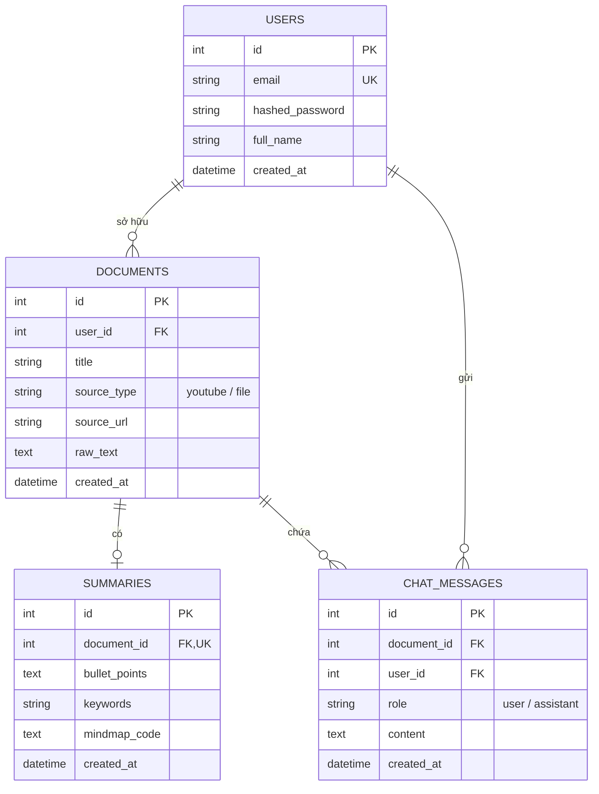

# Nền Tảng SaaS Tự Động Tóm Tắt & Trích Xuất Ý Chính Bài Học (AI Study Summarizer)

> **Đề tài:** Nền tảng SaaS Tự động Tóm tắt và Trích xuất Ý chính Bài học/Tài liệu (AI Study Summarizer)  
> **Kiến trúc:** Client - Server (FastAPI + React Vite + Tailwind CSS + Google Gemini AI)  
> **Phiên bản:** 1.0.0 (Chuẩn Đồ Án Tốt Nghiệp / Báo Cáo Chuyên Ngành)

---

## 1. Bài Toán Thực Tế (Problem) & Giải Pháp (Solution)

- **Vấn đề:** Sinh viên, học sinh và người đi làm phải tiếp thu lượng kiến thức khổng lồ từ các video bài giảng kéo dài hàng giờ hoặc giáo trình tài liệu PDF/Word dày cộp, mất rất nhiều thời gian ghi chép và tổng hợp trước kỳ thi hoặc cuộc họp.
- **Giải pháp:** Ứng dụng web SaaS thông minh:
  1. **Tự động tóm tắt video YouTube:** Lấy transcript tự động và chắt lọc kiến thức cốt lõi.
  2. **Tóm tắt tài liệu PDF/Word:** Bóc tách nội dung giáo trình thành các gạch đầu dòng dễ nhớ.
  3. **Trực quan hóa Sơ đồ tư duy (Mindmap):** Tự động sinh sơ đồ Mermaid Mindmap trực quan, hỗ trợ ghi nhớ hình ảnh.
  4. **Hỏi đáp trực tiếp (Chat with Document):** Trợ lý AI giải đáp mọi thắc mắc dựa trên ngữ cảnh của bài giảng.
  5. **Tính năng SaaS Đa người dùng:** Hệ thống xác thực JWT (Đăng ký, Đăng nhập), lưu trữ lịch sử bài học của từng sinh viên.

---

## 2. Kiến Trúc Hệ Thống (System Architecture)

```
[ Frontend: React (Vite + Tailwind CSS + Mermaid.js) ]
                        │
                        ▼  RESTful JSON API / JWT Bearer
[ Backend: FastAPI (Python 3.10+) ] ── Swagger Docs (/docs)
   ├── Routers: /auth, /summarize, /chat, /history
   ├── Core Services: YouTube Subtitle, PDF/DOCX Parser, Gemini AI Engine
   └── Database: SQLite / PostgreSQL (SQLAlchemy ORM)
```

---

## 3. Sơ Đồ Cơ Sở Dữ Liệu (ERD)



---

## 4. Hướng Dẫn Cài Đặt & Chạy Ứng Dụng

### Bước 1: Chuẩn bị Khóa API Google Gemini
1. Truy cập [Google AI Studio](https://aistudio.google.com/) để lấy API Key miễn phí.
2. Mở file `backend/.env` và dán key của bạn vào:
   ```env
   GOOGLE_API_KEY=your_actual_gemini_api_key_here
   GEMINI_MODEL=gemini-1.5-flash
   ```

### Bước 2: Chạy Backend (FastAPI)
Mở một cửa sổ Terminal:
```bash
./run_backend.sh
```
- API sẽ chạy tại: `http://localhost:8000`
- **Swagger UI Interactive Docs:** `http://localhost:8000/docs`

### Bước 3: Chạy Frontend (React Vite)
Mở một cửa sổ Terminal khác:
```bash
./run_frontend.sh
```
- Giao diện Web sẽ chạy tại: `http://localhost:5173`

---

## 5. Danh Sách RESTful API (Kiểm Tra Tại `/docs`)

| Method | Endpoint | Mô tả |
| :--- | :--- | :--- |
| `POST` | `/api/auth/register` | Đăng ký tài khoản người dùng |
| `POST` | `/api/auth/login` | Đăng nhập nhận JWT Access Token |
| `GET` | `/api/auth/me` | Lấy thông tin user hiện tại |
| `POST` | `/api/summarize/youtube` | Tóm tắt video bài giảng YouTube & sinh mindmap |
| `POST` | `/api/summarize/document` | Upload file PDF/DOCX để tóm tắt & sinh mindmap |
| `GET` | `/api/history` | Lấy danh sách lịch sử bài học |
| `GET` | `/api/documents/{id}` | Lấy chi tiết bài học và sơ đồ mindmap |
| `DELETE`| `/api/documents/{id}` | Xóa bài học khỏi lịch sử |
| `POST` | `/api/chat/{doc_id}` | Chat hỏi đáp trực tiếp với bài học |
| `GET` | `/api/chat/{doc_id}` | Lấy lịch sử hỏi đáp của bài học |

---

## 6. Điểm Nhấn Khi Bảo Vệ Đồ Án Trước Hội Đồng

1. **Chuẩn Kiến Trúc Phân Tầng:** Tách biệt hoàn toàn Frontend (SPA Client) và Backend (REST API), tuân thủ nguyên tắc Single Responsibility.
2. **Xử Lý Đa Phương Thức (Multimodal):** Hỗ trợ cả YouTube URL lẫn tài liệu văn bản PDF, Word (.docx).
3. **Trực Quan Hóa Tri Thức:** Không chỉ tóm tắt text mà còn render sơ đồ tư duy tương tác (Mermaid Mindmap).
4. **Trợ Lý Thông Minh Có Ngữ Cảnh:** Chatbot hỏi đáp được giới hạn chính xác trong phạm vi nội dung tài liệu (grounded answering).
5. **Swagger UI Chuyên Nghiệp:** Có thể demo trực tiếp các API trên `/docs` chứng minh tính độc lập và khả năng mở rộng của hệ thống.
